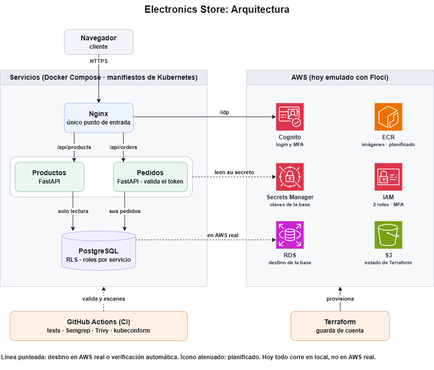
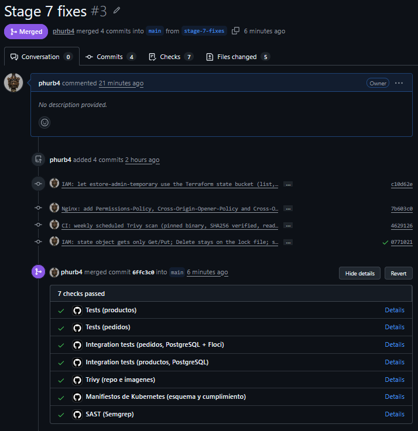
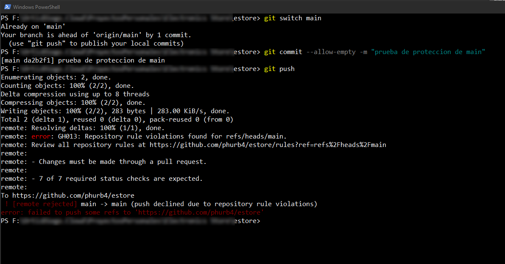
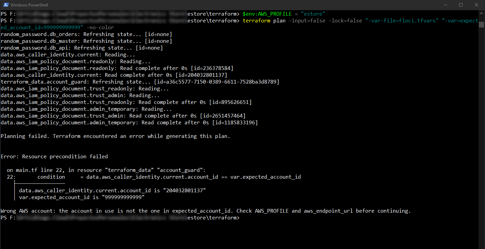
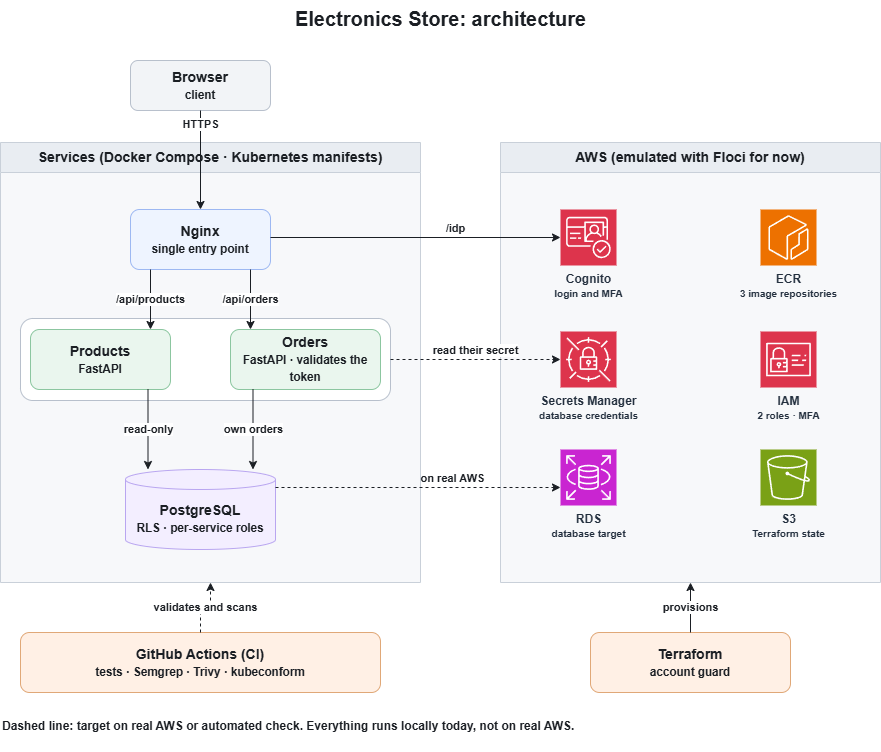

# Electronics Store (English below)

🇪🇸 Español · 🇬🇧 [English below](#english)

Tienda online ficticia de electrónica, construida como proyecto de portfolio de seguridad y cloud. No procesa pagos reales: es la excusa para mostrar un ciclo completo de **construcción segura** (Fase 1), sobre el que después se apoya un proyecto de monitoreo, detección y respuesta (Fase 2).

> **Transparencia:** diseñé la arquitectura y tomé las decisiones, pero soy nuevo escribiendo código e infraestructura. Usé Claude (IA) para generar código y comandos, y yo los ejecuté, probé y depuré. Cada cambio pasa por una rama, un pull request y un CI en verde, y cada herramienta elegida tiene documentadas las alternativas descartadas y el motivo.

## Estado actual

| Estado | Qué |
|---|---|
| ✅ **Funciona en local** | Frontend con Nginx, API de Productos, API de Pedidos, PostgreSQL, login con Amazon Cognito (sobre el emulador Floci) con MFA opcional por TOTP, e historial de pedidos por usuario |
| ✅ **Automatizado en CI** | Tests unitarios y de integración (PostgreSQL real, seguridad por filas y validación de tokens contra Floci), análisis estático con Semgrep, escaneo con Trivy (dependencias, secretos, configuración e imágenes), validación de los manifiestos de Kubernetes y un escaneo semanal programado |
| ✅ **Infraestructura como código** | Terraform contra Floci: Cognito, repositorios ECR, RDS, roles IAM, estado remoto en S3, AWS Budgets y Secrets Manager, con una guarda que frena si la cuenta no es la esperada |
| 🛠️ **Validado, sin probar en un cluster** | Manifiestos de Kubernetes con el estándar Pod Security «restricted» (17 de 17 controles en verde) |
| 📐 **Planificado** | Probar Kubernetes en un cluster, ZAP dentro del CI, Docker Compose leyendo de Secrets Manager y despliegue en una cuenta real de AWS |

**Todavía no corre en AWS real.** Todo lo anterior se ejecuta en un emulador local.

## Arquitectura

- **Frontend:** plantilla Electro (HTML/Bootstrap, sin React), servida por Nginx, que es el único punto de entrada (`/api/products`, `/api/orders` y `/idp`).
- **Productos:** API en Python (FastAPI) con un catálogo de 5 categorías y 21 productos de ejemplo.
- **Pedidos:** API en Python (FastAPI). Cada usuario ve solo sus pedidos, y el precio y el total se calculan siempre en el servidor.
- **Usuarios:** delegado a Amazon Cognito (registro, login y verificación en dos pasos opcional con TOTP). No hay un servicio propio.
- **Datos:** PostgreSQL con un rol de base distinto para cada servicio.
- **Local:** un solo `docker-compose.yml` levanta todo, incluido Floci.
- **Infraestructura:** Terraform, con un único código para el emulador y para AWS real; cada entorno se elige con su archivo de valores.

## Seguridad aplicada

**Aplicación**
- Validación de cada token en el servidor (firma, emisor, tipo, cliente y vencimiento).
- Permisos mínimos por servicio en la base y seguridad por filas (Row-Level Security) para aislar los pedidos de cada usuario.
- Límites de uso: 10 pedidos por hora por usuario y 30 solicitudes por minuto por IP en Nginx.
- Nginx sin versión visible y con cabeceras de seguridad (CSP, nosniff, Referrer-Policy, Permissions-Policy, COOP y CORP).
- Nada sensible en el navegador: el frontend nunca decide precios ni totales, y los datos externos se insertan como texto, nunca como HTML.

**Contenedores y dependencias**
- Contenedores sin root, con sistema de archivos de solo lectura y sin capacidades innecesarias; imágenes con versión fija.
- Dependencias de Python fijadas con hashes; librerías de CDN con `integrity`.
- Las imágenes se escanean con Trivy en cada cambio, y el CI falla si aparece una vulnerabilidad alta o crítica con corrección disponible.

**Pipeline y repositorio**
- `main` está protegida: nada entra sin pull request y sin que pasen las 7 comprobaciones del CI. Se probó que un push directo es rechazado.
- Trivy se instala con un binario de versión fija y SHA256 verificado, sin acciones de terceros; las acciones de GitHub están fijadas por commit.
- Sin credenciales en el código: todo sale de variables de entorno o de Secrets Manager.

**Infraestructura**
- Una guarda de Terraform compara la cuenta en uso con la esperada y frena el plan si no coinciden (probada en ambos sentidos).
- Dos roles con AssumeRole: uno de solo lectura permanente y otro de mayor privilegio para uso puntual, con MFA obligatorio y sesión de 1 hora.
- Base de datos cifrada y no pública; claves generadas por Terraform y guardadas en Secrets Manager; los servicios leen su secreto con permiso de solo lectura sobre ese secreto.

## Lo que encontró una revisión

Antes de dar por buena una etapa, se revisa. En una de esas revisiones apareció un fallo real: el rol de administración temporal podía modificar su propia política y darse permisos de administrador total. Se corrigió quitándole todas las acciones de escritura de IAM, y quedó documentado. También se detectaron vulnerabilidades en las imágenes base, que se actualizaron, y una regla de Semgrep que marcaba un falso positivo, que se silenció solo en esa línea y con el motivo escrito.

## Plan para AWS real

El destino es una cuenta de AWS dedicada, dentro del free tier. Antes de desplegar:

1. Confirmar el estado real del free tier y activar los avisos de AWS Budgets.
2. Probar los manifiestos de Kubernetes en un cluster y decidir cómo se ejecuta cada servicio según el costo.
3. Que los servicios en Kubernetes lean sus claves de Secrets Manager con una identidad propia por servicio.
4. Definir la red de la base de datos (subredes y grupo de seguridad), que hoy queda sin valores para el emulador.
5. Crear los recursos solo mientras se trabaja y destruirlos al terminar cada sesión.

El vínculo con la Fase 2 será ese rol de solo lectura permanente y el de mayor privilegio de uso puntual, mediante AWS STS AssumeRole.

## Límites declarados

1. No hay despliegue en AWS real ni se probó Kubernetes en un cluster todavía.
2. El emulador no evalúa las políticas de IAM ni la condición de MFA: esas políticas están escritas, pero no verificadas hasta usar una cuenta real.
3. Docker Compose sigue leyendo las claves de la base desde un archivo `.env` local; Secrets Manager se usa desde el código de los servicios y desde Terraform.
4. ZAP (DAST) se ejecutó de forma local y todavía no forma parte del CI.
5. No hay pagos: la tienda no procesa transacciones reales.
6. Las imágenes de los productos son provisorias y se van a reemplazar.

## Estructura

- `frontend/`: sitio estático (plantilla Electro) y configuración de Nginx.
- `services/productos/` y `services/pedidos/`: APIs y sus tests.
- `terraform/`: infraestructura como código.
- `k8s/`: manifiestos de Kubernetes.
- `.github/workflows/`: pipeline de CI y escaneo programado.

## Licencias

El código propio se rige por la licencia del repositorio (`LICENSE`). La plantilla Electro conserva su licencia en `frontend/LICENSE.txt` y mantiene el enlace «Designed By HTML Codex» que ella exige.

El archivo `.github/crd-schemas/secrets-store.csi.x-k8s.io/secretproviderclass_v1.json` es una copia local de un esquema del repositorio `datreeio/CRDs-catalog` (commit `04af58d`), con licencia MIT, Copyright (c) 2022 datree.io. Solo lo usa la validación de manifiestos del CI (kubeconform).

---

# Electronics Store — English

A fictional online electronics store built as a security and cloud portfolio project. It processes no real payments: it is the excuse to show a full **secure build** cycle (Phase 1), on top of which a monitoring, detection and response project (Phase 2) will be built.

> **Transparency:** I designed the architecture and made the decisions, but I am new to writing code and infrastructure. I used Claude (AI) to generate code and commands, and I ran, tested and debugged them. Every change goes through a branch, a pull request and a green CI, and every tool I picked has its discarded alternatives and the reason documented.

## Current status

| Status | What |
|---|---|
| ✅ **Works locally** | Nginx frontend, Products API, Orders API, PostgreSQL, Amazon Cognito login (on the Floci emulator) with optional TOTP MFA, and per-user order history |
| ✅ **Automated in CI** | Unit and integration tests (real PostgreSQL, row-level security and token validation against Floci), static analysis with Semgrep, Trivy scans (dependencies, secrets, configuration and images), Kubernetes manifest validation and a scheduled weekly scan |
| ✅ **Infrastructure as code** | Terraform against Floci: Cognito, ECR repositories, RDS, IAM roles, remote state in S3, AWS Budgets and Secrets Manager, with a guard that stops if the account is not the expected one |
| 🛠️ **Validated, not run on a cluster** | Kubernetes manifests with the Pod Security "restricted" standard (17 of 17 controls passing) |
| 📐 **Planned** | Run Kubernetes on a cluster, ZAP inside CI, Docker Compose reading from Secrets Manager and deployment to a real AWS account |

**It does not run on real AWS yet.** Everything above runs on a local emulator.

## Architecture

- **Frontend:** Electro template (HTML/Bootstrap, no React) served by Nginx, the single entry point (`/api/products`, `/api/orders` and `/idp`).
- **Products:** Python API (FastAPI) with a catalog of 5 categories and 21 sample products.
- **Orders:** Python API (FastAPI). Each user sees only their own orders, and price and total are always computed on the server.
- **Users:** delegated to Amazon Cognito (sign-up, login and optional TOTP two-step verification). There is no custom service.
- **Data:** PostgreSQL with a different database role for each service.
- **Local:** a single `docker-compose.yml` starts everything, Floci included.
- **Infrastructure:** Terraform, one codebase for the emulator and for real AWS; each environment is chosen with its own values file.

## Security applied

**Application**
- Every token is validated on the server (signature, issuer, type, client and expiry).
- Least-privilege database roles per service and Row-Level Security to isolate each user's orders.
- Rate limits: 10 orders per hour per user and 30 requests per minute per IP in Nginx.
- Nginx hides its version and sends security headers (CSP, nosniff, Referrer-Policy, Permissions-Policy, COOP and CORP).
- Nothing sensitive in the browser: the frontend never decides prices or totals, and external data is inserted as text, never as HTML.

**Containers and dependencies**
- Containers run without root, with a read-only filesystem and no unnecessary capabilities; images use pinned versions.
- Python dependencies are pinned with hashes; CDN libraries carry `integrity`.
- Images are scanned with Trivy on every change, and CI fails on any high or critical vulnerability that has a fix.

**Pipeline and repository**
- `main` is protected: nothing is merged without a pull request and the 7 CI checks passing. A direct push was tested and rejected.
- Trivy is installed from a pinned binary with a verified SHA256, with no third-party actions; GitHub Actions are pinned by commit.
- No credentials in the code: everything comes from environment variables or Secrets Manager.

**Infrastructure**
- A Terraform guard compares the account in use with the expected one and stops the plan if they differ (tested both ways).
- Two roles with AssumeRole: a permanent read-only one and a higher-privilege one for one-off use, with mandatory MFA and a 1-hour session.
- The database is encrypted and not public; passwords are generated by Terraform and stored in Secrets Manager; each service reads its own secret with read-only permission on it.

## What a review found

Before accepting a stage, it is reviewed. One of those reviews found a real flaw: the temporary admin role could edit its own policy and grant itself full administrator rights. It was fixed by removing every IAM write action from that role, and documented. The reviews also found vulnerabilities in the base images, which were updated, and a Semgrep false positive, which was silenced only on that line with the reason written next to it.

## Plan for real AWS

The target is a dedicated AWS account within the free tier. Before deploying:

1. Confirm the real free tier status and enable AWS Budgets alerts.
2. Run the Kubernetes manifests on a cluster and decide how each service runs depending on cost.
3. Have the Kubernetes services read their secrets from Secrets Manager with their own identity per service.
4. Define the database network (subnets and security group), currently left empty for the emulator.
5. Create resources only while working and destroy them at the end of each session.

The link with Phase 2 will be that permanent read-only role and the higher-privilege one for one-off use, through AWS STS AssumeRole.

## Declared limits

1. There is no deployment on real AWS and Kubernetes has not been run on a cluster yet.
2. The emulator does not evaluate IAM policies or the MFA condition: those policies are written but unverified until a real account is used.
3. Docker Compose still reads the database passwords from a local `.env` file; Secrets Manager is used from the services' code and from Terraform.
4. ZAP (DAST) was run locally and is not part of CI yet.
5. There are no payments: the store processes no real transactions.
6. Product images are temporary and will be replaced.

## Structure

- `frontend/`: static site (Electro template) and Nginx configuration.
- `services/productos/` and `services/pedidos/`: APIs and their tests.
- `terraform/`: infrastructure as code.
- `k8s/`: Kubernetes manifests.
- `.github/workflows/`: CI pipeline and scheduled scan.

## Licenses

The project's own code is covered by the repository license (`LICENSE`). The Electro template keeps its license in `frontend/LICENSE.txt` and keeps the "Designed By HTML Codex" link that it requires.

The file `.github/crd-schemas/secrets-store.csi.x-k8s.io/secretproviderclass_v1.json` is a local copy of a schema from the `datreeio/CRDs-catalog` repository (commit `04af58d`), MIT License, Copyright (c) 2022 datree.io. It is used only by the CI manifest validation (kubeconform).
